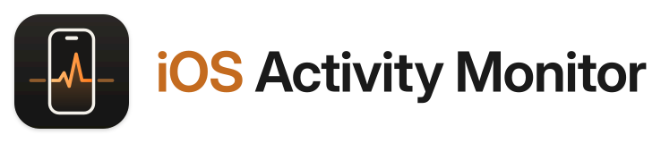
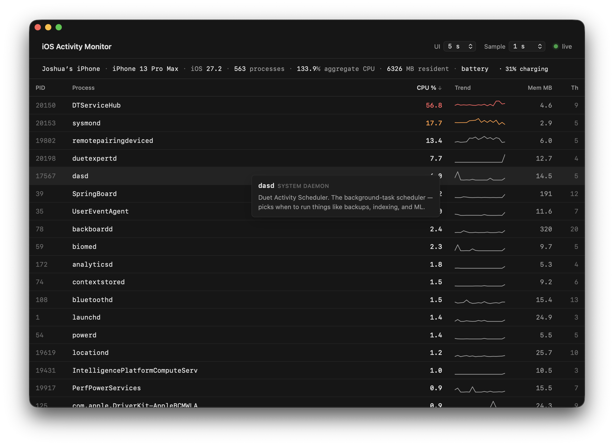

<h1 align="center">
  <picture>
    <source media="(prefers-color-scheme: dark)" srcset="assets/logo-wordmark-dark.svg">
    
  </picture>
</h1>

A live process monitor for an iPhone or iPad connected over USB. Like macOS Activity Monitor, but for iOS.



A standalone Mac app that streams per-process CPU, memory and thread counts from the device in real time, with hover-to-explain tooltips for common iOS daemons.

Useful when your iPhone is running hot and you want to know why.

## Requirements

- A Mac with Apple silicon, running macOS 15 or later.
- An iPhone or iPad running iOS 17.4 or later, connected over USB.

The first time you connect a device, the app walks you through tapping Trust and turning on Developer Mode. It needs no `sudo` and no other software.

## Build

Building needs Xcode, [`uv`](https://docs.astral.sh/uv/), and `librsvg` (`brew install librsvg`).

```bash
git clone https://github.com/joshuaswanson/ios-activity-monitor.git
cd ios-activity-monitor
scripts/build-app.sh
```

This produces `build/iOS Activity Monitor.app`. Drag it to `/Applications`.

## How it works

The app subscribes to the [`com.apple.instruments.server.services.sysmontap`](https://github.com/doronz88/pymobiledevice3) service on the device, the same one Xcode's Instruments uses for its "Activity Monitor" template.

The app has two parts inside its bundle:

- A native window that shows the interface in `app/Resources/ui`. The files load directly from the bundle.
- A private Python runtime that runs the device engine in `src/ios_activity_monitor`, built on `pymobiledevice3`. The window starts it and exchanges JSON with it over a pipe. It exits when the app quits.

The engine opens the developer tunnel itself and carries it over the USB connection, so it runs as your normal user.

Collecting the data uses CPU on the device, so `DTServiceHub`, `sysmond` and `remotepairingdeviced` appear near the top of the list while the monitor is running.

Engine logs are in `~/Library/Logs/iOS Activity Monitor/engine.log`.

## Support

If you find this useful, [buy me a coffee](https://buymeacoffee.com/swanson).


## License

MIT.
